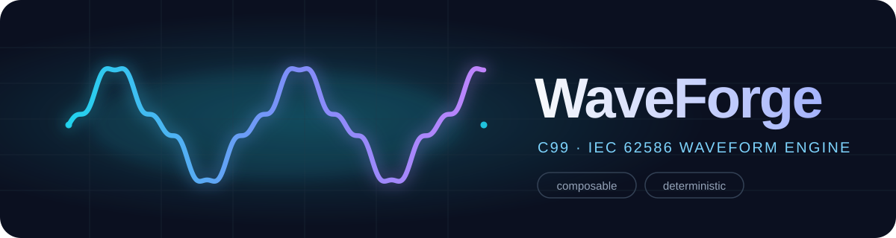
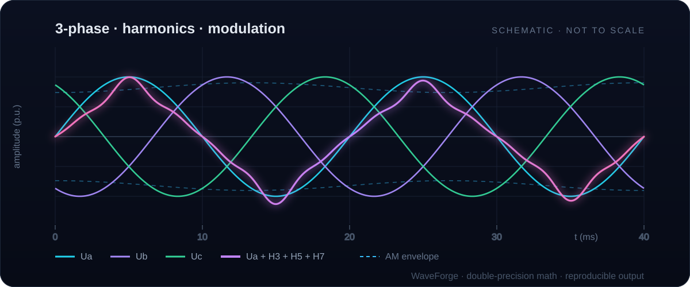
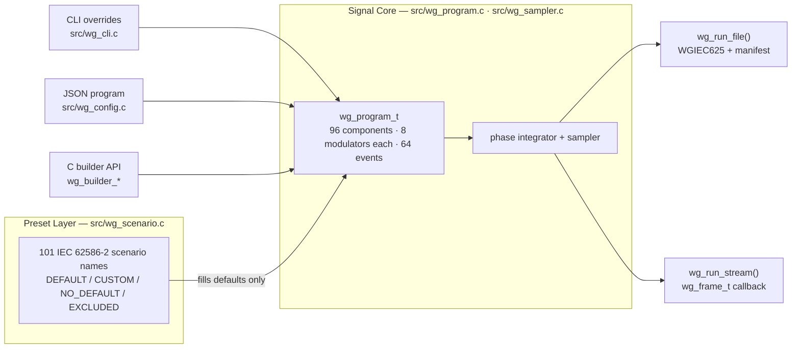

<div align="center">



### Composable, deterministic IEC 62586 waveform generation in C99

One evaluation core. Arbitrary components. File or stream. Zero dependencies.


<a href="https://github.com/2502797718/waveforge-iec62586/actions/workflows/ci.yml"></a>


</div>

**English** | [简体中文](README.zh-CN.md)



## What it is

WaveForge turns a continuous-time signal model into discrete, timestamped, multi-channel
waveforms. Built-in presets follow the IEC 62586-2 clause structure (6.1–6.13; clauses 6.14–6.17
are supplied as current-channel recipes), but every value they set is a **default you can
override** — a preset never locks a parameter, and it never invents a number the standard does
not give.

It is a waveform *generator*, not a certification tool: it produces the ideal stimulus that a
power-quality instrument is supposed to receive. It does not judge IEC conformity, model analog
hardware, or reproduce standard text.

## Why WaveForge

- **Arbitrary signal construction.** Up to 96 components — fundamental, harmonics 2–64,
  fractional interharmonics (1.5, 7.5, 49.5), absolute carrier tones — each with its own chain of
  up to 8 amplitude or frequency modulators. Add absolute-time events and one-level segments on top.
- **Presets are defaults, not locks.** A scenario fills a starting configuration; `--freq`,
  `--amp`, `--harmonics`, a JSON `program`, or the C API can replace any field. When a standard
  value is missing, the preset returns `CUSTOM` / `NO_DEFAULT` with the exact field path instead of
  guessing.
- **One core, two sinks.** `wg_run_file()` writes the `WGIEC625` container plus a manifest;
  `wg_run_stream()` delivers the same frames through a callback with O(1) memory. File and stream
  are byte-identical by construction.
- **Pure math, reproducible.** C99 plus `libm`, `double` phase integration, integer-nanosecond
  timestamps recomputed from the sample index. Same build + same config + fixed start time means
  byte-identical output and the same SHA-256.

## Features

| Layer | What you get |
|---|---|
| **Signal core** | Four component kinds, nine modulator kinds, `amp_step` / `phase_step` events, one-level segments with `immediate` or `zero_crossing` switching. |
| **Preset layer** | IEC 62586-2 scenario names for clauses 6.1–6.13 plus 3 frequency aliases; clauses 6.14–6.17 are recipe-level mappings over explicit current channels. Each preset only supplies defaults. |
| **Output** | `WGIEC625` file (64 B header, 56 B frame headers, 32 B trailer), f64 / f32 / i24 samples, planar channel layout, `<file>.manifest.json` with SHA-256. |
| **Streaming** | `wg_run_stream()` frame callback with constant memory, suitable for multi-hour runs; `samples` is valid only inside the callback. |
| **Verification** | 16 self-tests, 6 regression scenarios, independent `verify.py` / `check_acceptance.py` that rebuild the expected signal from the published format and manifest. |
| **Dependencies** | C99 standard library and `libm` only. Python 3.8+ is needed only for the independent verifier and uses the standard library alone. |

## How it compares

WaveForge is honest about what it is: a host-side waveform engine.

| | **WaveForge** | Commercial signal source | Hand-written scripts |
|---|---|---|---|
| Form | C99 library + CLI, host side | Rack hardware / power amplifier | NumPy / MATLAB glue per project |
| Output | f64 / f32 / i24 samples, file or frame callback | Real volts and amps, real clock | Whatever the script writes |
| Accuracy comes from | `double` math checked against analytic expressions | DAC, front end, clock, calibration | The math in that script |
| Reproducibility | Same build + config + start time ⇒ same SHA-256 | Hardware and thermal drift | Library-version dependent |
| Signal composition | 96 components × 8 modulators, events, segments | Fixed menu of waveform types | Unlimited, but each case is new code |
| Cost | MIT, no hardware | Purchase plus calibration | Engineering time |
| Best for | Algorithm development, replay, CI regression, format bring-up | Type tests, metrology, hardware validation | One-off experiments |

WaveForge does not replace a hardware source: it produces the *ideal* waveform that a hardware
source is supposed to emit. See the [FAQ](doc/faq.md) for the full boundary.

## Architecture



The preset layer only fills defaults; it never writes samples. The core knows nothing about
IEC 62586 or test numbering, so standard presets and user-defined signals share exactly one
evaluation path. Frequencies are integrated (`φ[n+1] = φ[n] + 2π·f/fs`), never evaluated as
`2π·f(t)·t`, so phase stays continuous through frequency changes.

## Quick start

```sh
git clone https://github.com/2502797718/waveforge-iec62586.git
cd waveforge-iec62586
make                                                    # build/libwaveforge.a, build/wg, build/selftest
./build/wg list                                         # 104 rows: 101 scenarios + 3 aliases
./build/wg gen --test A1.2.2 --system 50 --duration 60 --out a122.bin
python3 tools/verify.py a122.bin --report a122.verify.json
```

Requirements: a C99 compiler and `make` (or CMake ≥ 3.16) plus `libm`. Python 3.8+ is needed only
by the independent verifier.

CMake works too:

```sh
cmake -S . -B build/cmake
cmake --build build/cmake
ctest --test-dir build/cmake --output-on-failure
```

## CLI examples

```sh
# Frequency triangle 42.5 ↔ 57.5 Hz, 120 s
./build/wg gen --test A1.1.1 --duration 120 --out a111.bin

# Three-phase sequential dip and recovery, zero-crossing switching, 15 s
./build/wg gen --test A4.2.1 --duration 15 --out a421.bin

# Third harmonic at 10 %, 2 s
./build/wg gen --test A6.2.2 --duration 2 --out h3.bin

# Sine AM (2.3 Hz, 10 %) plus a +30° phase step at t = 5 s
./build/wg gen --test A1.2.2 --duration 10 --mod sine:2.3:10:0 \
  --phase-step 5.0:30 --out am_step.bin

# Rectangular AM: 10 Hz, 5 % depth, 50 % duty
./build/wg gen --test A1.2.2 --duration 10 --mod rect:10:5:50:0 --out rect.bin
```

`--mod` accepts `sine:FM:DEPTH[:PHASE]` and `rect:FM:DEPTH:DUTY[:PHASE]`, is repeatable, and
applies to the fundamental. Merging order is fixed: defaults → `--system` → `--test` →
`--config` → remaining overrides. Unknown options and unknown JSON keys are rejected, never
ignored.

## JSON program

When CLI flags are not enough — linear/triangle ramps, frequency profiles, amplitude events —
write a single-level JSON program:

```json
{
  "time": { "duration_s": 10, "sample_rate_hz": 51200 },
  "channels": ["Ua", "Ub", "Uc"],
  "program": {
    "components": [
      {
        "kind": "fundamental",
        "frequency_hz": 50,
        "amp_pct": 100,
        "phase_deg": { "Ua": 0, "Ub": -120, "Uc": 120 },
        "modulators": [
          { "kind": "amp_sine", "frequency_hz": 2.3, "depth_pct": 10 },
          { "kind": "freq_triangle", "from": 40, "to": 60, "period_s": 10 }
        ]
      },
      { "kind": "harmonic", "order": 3, "amp_pct": 7, "phase_deg": 45 },
      { "kind": "interharmonic", "order": 1.5, "amp_pct": 5 },
      { "kind": "tone", "frequency_hz": 1060, "amp_pct": 1 }
    ],
    "events": [
      { "kind": "phase_step", "time_s": 5, "channel_mask": "Ua,Ub,Uc", "value": 30 }
    ]
  }
}
```

```sh
./build/wg gen --config my.json --out custom.bin
```

`period_s` is the full round trip: 40 → 60 → 40 Hz uses `10`, not one leg. A `phase_step` adds to
the integrated phase, so a +30° step moves H3 by +90° while the 1060 Hz tone is unaffected.
Field-by-field constraints live in [Input format](doc/input-format.md).

## C API

```c
#include <stdio.h>
#include <string.h>

#include "wg.h"

static int32_t on_frame(const wg_frame_t *f, void *ctx)
{
    (void)f;
    (void)ctx;
    return 0;   /* non-zero aborts and becomes wg_run_stream()'s return value */
}

int main(void)
{
    const uint8_t ch[3]  = { WG_CH_UA, WG_CH_UB, WG_CH_UC };
    const double  nom[3] = { 220.0, 220.0, 220.0 };
    wg_builder_t *b = wg_builder_create(51200u, 0u);
    wg_component_t c;
    wg_handle_t *h;
    char err[256];

    if (b == NULL) return 1;
    wg_builder_set_channels(b, ch, 3u, nom);
    wg_builder_set_duration(b, 10.0);
    wg_builder_set_output(b, (uint8_t)WG_FMT_F64, 256u);

    /* Fundamental: 50 Hz, 100 %, phases 0 / -120 / +120 */
    memset(&c, 0, sizeof(c));
    c.kind = WG_COMP_FUNDAMENTAL;
    c.order = 1.0;
    c.frequency_hz = 50.0;
    c.channel_mask = 0x07u;
    c.amp_pct[WG_CH_UA] = c.amp_pct[WG_CH_UB] = c.amp_pct[WG_CH_UC] = 100.0;
    c.phase_deg[WG_CH_UB] = -120.0;
    c.phase_deg[WG_CH_UC] = 120.0;
    wg_builder_add_component(b, &c);

    h = wg_create_from_builder(b, err, sizeof(err));
    wg_builder_destroy(b);            /* the handle owns its own copy */
    if (h == NULL) {
        fprintf(stderr, "%s\n", err);
        return 1;
    }

    wg_run_file(h, "out.bin");        /* file sink + out.bin.manifest.json */
    wg_run_stream(h, on_frame, NULL); /* same frames, constant memory */
    wg_destroy(h);
    return 0;
}
```

```sh
cc -std=c99 -O2 -Iinclude my_tool.c build/libwaveforge.a -lm -o my_tool
```

The builder is allocated on the heap (about 121 KB of configuration), so it will not overflow a
thread stack. `wg_run_stream()` gives you `wg_frame_t` callbacks for unbounded durations with
constant memory; `samples` is valid only during the callback. A handle may be reused; each run
restarts at t = 0.

## Standards coverage

Presets follow the IEC 62586-2 clause structure. Values below are **our defaults for reproducible
regression**, not the standard text.

| Clause | Topic | What WaveForge can express |
|---|---|---|
| 6.1 | Power frequency | Steady levels, linear/triangle frequency profiles, phase-continuous changes |
| 6.2 | Supply voltage magnitude | Steady levels, sine AM, triangle envelope, long runs |
| 6.3 | Flicker | Rectangular AM with configurable CPM, depth and duty |
| 6.4 | Interruptions, dips, swells | Per-phase amplitude sequences, zero-crossing segments |
| 6.5 | Supply voltage unbalance | Independent per-phase amplitude and phase |
| 6.6 | Voltage harmonics | Harmonics 2–64, S1 group, amplitude ramps |
| 6.7 | Voltage interharmonics | Fractional orders such as 1.5 / 7.5 / 49.5 |
| 6.8 | Carrier signals | Absolute tones at 315–2975 Hz, independent of the fundamental |
| 6.9 | Under/over deviation | Steady levels and alternating step sequences |
| 6.10 | Flagging | 100 ms single-, two- and three-phase events |
| 6.11 | Clock uncertainty | Arbitrary start UTC, timed interruption, recomputable timestamps |
| 6.12 | Influence quantities | `EXCLUDED` — environmental tests are not a waveform-generator duty |
| 6.13 | Rapid voltage changes | Half-cycle segments and ramps |
| 6.14–6.17 | Current signals | Explicit current channels, harmonics, interharmonics, unbalance |

`wg list` prints 104 rows: **101 scenarios + 3 frequency aliases**.

| Status | Count | Meaning |
|---|---|---|
| `DEFAULT` | 81 scenarios (+3 aliases) | Preset values are complete; generate directly |
| `CUSTOM` | 4 | The standard gives no numeric stimulus; supply your own fields |
| `NO_DEFAULT` | 15 | A required level or declaration is missing; the preset names the field |
| `EXCLUDED` | 1 | Not a waveform-generator responsibility |

`CUSTOM` and `NO_DEFAULT` are **not** missing capabilities: fill in the field the preset names
through `--freq`, `--amp`, `--harmonics` or a JSON `program` and generation proceeds. All preset
numbers can be overridden. This repository does not reproduce standard text, tables or scans;
obtain the originals from IEC or an authorised channel.

## Verification

| Layer | What runs | What it checks |
|---|---|---|
| Self-test | `make test` → 13 cases | Configuration validation, stream timing, file-vs-stream bytes, determinism, phase continuity, i24 scaling, a 660 s streaming run, arbitrary components, per-component envelopes, stacked modulation, custom triangles, `NO_DEFAULT`, legacy compatibility |
| Regression | 6 fixed scenarios | A1.1.1, A2.5.1, A4.2.1, A5.1.2, A6.2.2, A8.1.3 |
| Independent check | `tools/verify.py`, `tools/check_acceptance.py` | Structure, timestamps, RMS/frequency/phase rebuilt from the manifest or from per-case analytic expectations |

Tolerances are **mathematical reconstruction tolerances**, not IEC limits: fundamental RMS
≤ 0.1 %, frequency ≤ 1 mHz, phase ≤ 0.1°, harmonic RMS ≤ 0.5 %, timestamps exact in integer
nanoseconds. Components carrying modulators, profiles or events are marked `DYNAMIC` and skipped
by the steady-state check; a file-level summary of `PARTIAL` therefore means "structure PASS,
dynamic component by design", not a deviation.

Nothing here judges IEC conformity or hardware performance. See
[Verification](doc/verification.md).

## Documentation

| Document | Contents |
|---|---|
| [Architecture](doc/architecture.md) | Two-layer design, program model, determinism, boundaries |
| [Input format](doc/input-format.md) | CLI and JSON contract, defaults, error format, capacity |
| [Output format](doc/output-format.md) | `WGIEC625` header/frame/trailer layout, i24 scaling, manifest |
| [Signal catalog](doc/signal-catalog.md) | Clause-by-clause capabilities and preset defaults |
| [Standard mapping](doc/standard-mapping.md) | Scenario names traced to clause numbers and primitives |
| [User manual](doc/user-manual.md) | Task-oriented usage guide (Chinese) |
| [User manual (EN)](doc/user-manual.en.md) | Task-oriented usage guide (English) |
| [Verification](doc/verification.md) | Acceptance criteria, self-tests, regression procedure |
| [FAQ](doc/faq.md) | Comparisons, boundaries, troubleshooting |
| [Project log](doc/project-log.md) | Evolution, decisions, known issues |

## Roadmap

- [x] Two-layer Signal Core / Preset Layer refactor
- [x] Static library + CLI with Make and CMake builds, CTest registration
- [x] JSON `program`, builder API and legacy `signal` compatibility
- [ ] Re-verify the RVC defaults (A13.3.1–A13.5.2) against the source tables
- [ ] Add 6.14–6.17 current scenarios to `wg list`
- [ ] Golden-file fixtures for f32 and i24 output
- [ ] Python bindings over the stream API
- [ ] Extend the CI matrix to macOS and Windows (self-test via WSL)
- [ ] More worked examples under `examples/`

## Contributing

Issues and pull requests are welcome. Read [CONTRIBUTING.md](CONTRIBUTING.md) first — it covers
build/test commands, code style, commit conventions and documentation rules. Participation is
governed by the [Code of Conduct](CODE_OF_CONDUCT.md). Security reports go through
[SECURITY.md](SECURITY.md); changes are recorded in [CHANGELOG.md](CHANGELOG.md).

## License

MIT — see [LICENSE](LICENSE). Copyright (c) 2026 WaveForge contributors.

## Disclaimer

- WaveForge generates **mathematical test stimuli**. It is not a certification or type-test tool
  and does not produce IEC conformity verdicts.
- It makes no claims about DACs, analog front ends, anti-aliasing filters, instrument
  transformers or real-time clocks.
- IEC 62586-2, IEC 61000-4-7, IEC 61000-4-15 and IEC 61000-2-4 are copyrighted. No standard text,
  table or scan is reproduced here; obtain the originals from IEC or an authorised channel.
- Preset numbers are our defaults. They are not a substitute for the standard.
