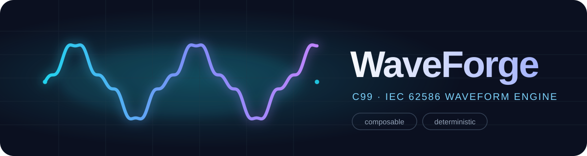
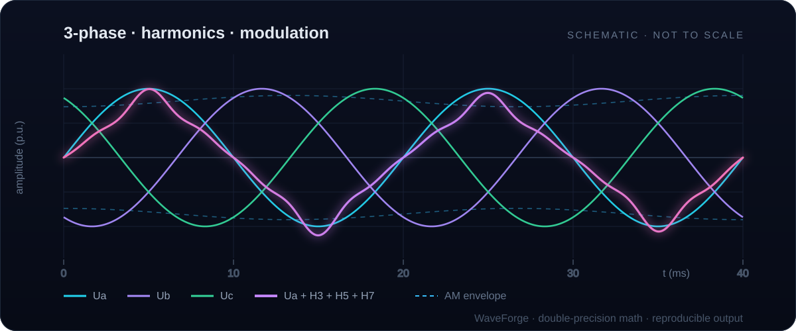
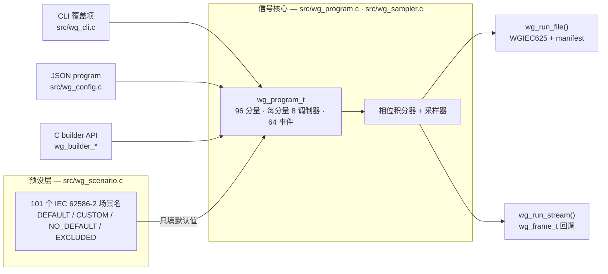

<div align="center">



### 用 C99 组合并确定性生成 IEC 62586 波形

单一求值核心 · 任意分量 · 文件或流 · 零依赖


<a href="https://github.com/2502797718/waveforge-iec62586/actions/workflows/ci.yml"></a>


</div>

[English](README.md) | **简体中文**



## 这是什么

WaveForge 把连续时间信号模型离散化为带绝对时间戳的多通道波形。内置预设按 IEC 62586-2 的条款结构组织（6.1–6.13；6.14–6.17 以电流通道配方提供），但预设设置的每一个数值都只是**可被覆盖的默认值**：预设从不锁定参数，也不会凭空编造标准未给出的数值。

它是一个波形**发生器**，不是认证工具：它产生的是电能质量仪器“应该收到”的理想激励。它不判定 IEC 合格性，不模拟模拟硬件，也不复制标准原文。

## 为什么选 WaveForge

- **任意信号构造。** 最多 96 个分量——基波、2–64 次谐波、小数次间谐波（1.5、7.5、49.5）、绝对频点载波——每个分量各自拥有最多 8 条幅值或频率调制器。其上还可以叠加绝对时间事件与一层分段。
- **预设只是默认值，不是锁。** 场景只提供起始配置；`--freq`、`--amp`、`--harmonics`、JSON `program` 或 C API 可以替换任意字段。标准缺值时，预设返回 `CUSTOM` / `NO_DEFAULT` 和精确字段路径，而不是猜一个数。
- **一个核心，两种输出。** `wg_run_file()` 写出 `WGIEC625` 容器与 manifest；`wg_run_stream()` 通过回调交付同样的帧，内存恒定。文件与流按构造即逐字节一致。
- **纯数学，可复现。** 只需要 C99 与 `libm`；`double` 相位积分，整数纳秒时间戳按样本序号重算。同一构建 + 同一配置 + 固定起始时间 ⇒ 输出逐字节一致，SHA-256 相同。

## 功能

| 层 | 内容 |
|---|---|
| **信号核心** | 四种分量、九种调制器、`amp_step` / `phase_step` 事件、一层 `immediate` / `zero_crossing` 分段。 |
| **预设层** | 覆盖 6.1–6.13 的 IEC 62586-2 场景名与 3 个频率别名；6.14–6.17 以显式电流通道的配方映射提供。预设只填默认值。 |
| **输出** | `WGIEC625` 文件（64 B 文件头、56 B 帧头、32 B 结束记录）、f64 / f32 / i24 样本、平面通道排列、带 SHA-256 的 `<file>.manifest.json`。 |
| **流式输出** | `wg_run_stream()` 逐帧回调，内存恒定，适合多小时长跑；`samples` 仅在回调期间有效。 |
| **校验** | 14 项自测、6 个回归场景，以及独立 `verify.py` / `check_acceptance.py`：只按公开格式与 manifest 重建预期信号。 |
| **依赖** | 仅 C99 标准库与 `libm`。Python 3.8+ 只有独立校验器需要，且只用标准库。 |

## 与其它方案对比

WaveForge 对自己的定位很明确：主机侧波形引擎。

| | **WaveForge** | 商业信号源 | 自己写脚本 |
|---|---|---|---|
| 形态 | C99 库 + CLI，主机侧 | 机架硬件 / 功率放大器 | 每个项目一份 NumPy / MATLAB 胶水代码 |
| 输出 | f64 / f32 / i24 样本，文件或帧回调 | 真实电压电流与真实时钟 | 脚本自己决定 |
| 精度来源 | `double` 数学计算，按解析式核对 | DAC、模拟前端、时钟、校准 | 脚本里的数学实现 |
| 可复现 | 同一构建 + 配置 + 起始时间 ⇒ 相同 SHA-256 | 受硬件与温漂影响 | 依赖库版本 |
| 信号组合 | 96 分量 × 8 调制器，含事件与分段 | 固定的波形菜单 | 无限灵活，但每个新用例都要新代码 |
| 成本 | MIT，无硬件成本 | 采购与校准成本 | 工程时间 |
| 最适合 | 算法开发、回放、CI 回归、格式联调 | 型式试验、计量、硬件验证 | 一次性实验 |

WaveForge 不替代硬件信号源：它产生的是“**应该**送给硬件的理想波形”。完整边界见 [FAQ](doc/faq.md)。

## 架构



预设层只填默认值，从不写样本。核心不知道 IEC 62586，也不知道测试编号，因此标准预设与用户自定义信号共享同一条求值路径。频率一律用相位积分（`φ[n+1] = φ[n] + 2π·f/fs`），而不是 `2π·f(t)·t`，频率变化时相位保持连续。

## 快速开始

```sh
git clone https://github.com/2502797718/waveforge-iec62586.git
cd waveforge-iec62586
make                                                    # 生成 build/libwaveforge.a、build/wg、build/selftest
./build/wg list                                         # 104 行：101 个场景 + 3 个别名
./build/wg gen --test A1.2.2 --system 50 --duration 60 --out a122.bin
python3 tools/verify.py a122.bin --report a122.verify.json
```

依赖：C99 编译器与 `make`（或 CMake ≥ 3.16），链接 `libm`。Python 3.8+ 只有独立校验器需要。

也可以用 CMake：

```sh
cmake -S . -B build/cmake
cmake --build build/cmake
ctest --test-dir build/cmake --output-on-failure
```

## CLI 示例

```sh
# 42.5 ↔ 57.5 Hz 频率三角，120 s
./build/wg gen --test A1.1.1 --duration 120 --out a111.bin

# 三相依次暂降与恢复，过零切换，15 s
./build/wg gen --test A4.2.1 --duration 15 --out a421.bin

# 三次谐波 10 %，2 s
./build/wg gen --test A6.2.2 --duration 2 --out h3.bin

# 2.3 Hz / 10 % 正弦调幅，并在 t = 5 s 加 +30° 相位阶跃
./build/wg gen --test A1.2.2 --duration 10 --mod sine:2.3:10:0 \
  --phase-step 5.0:30 --out am_step.bin

# 矩形调幅：10 Hz、深度 5 %、占空比 50 %
./build/wg gen --test A1.2.2 --duration 10 --mod rect:10:5:50:0 --out rect.bin
```

`--mod` 接受 `sine:FM:DEPTH[:PHASE]` 与 `rect:FM:DEPTH:DUTY[:PHASE]`，可重复，作用于基波。合并顺序固定为：默认值 → `--system` → `--test` → `--config` → 其余覆盖项。未知选项与未知 JSON 键一律报错，不会静默忽略。

## JSON program

当 CLI 选项不够用时——线性/三角斜坡、频率轮廓、幅值事件——写一份单层 JSON：

```json
{
  "time": { "duration_s": 10, "sample_rate_hz": 51200 },
  "channels": ["Ua", "Ub", "Uc"],
  "program": {
    "components": [
      {
        "kind": "fundamental",
        "frequency_hz": 50,
        "amp_pct": 100,
        "phase_deg": { "Ua": 0, "Ub": -120, "Uc": 120 },
        "modulators": [
          { "kind": "amp_sine", "frequency_hz": 2.3, "depth_pct": 10 },
          { "kind": "freq_triangle", "from": 40, "to": 60, "period_s": 10 }
        ]
      },
      { "kind": "harmonic", "order": 3, "amp_pct": 7, "phase_deg": 45 },
      { "kind": "interharmonic", "order": 1.5, "amp_pct": 5 },
      { "kind": "tone", "frequency_hz": 1060, "amp_pct": 1 }
    ],
    "events": [
      { "kind": "phase_step", "time_s": 5, "channel_mask": "Ua,Ub,Uc", "value": 30 }
    ]
  }
}
```

```sh
./build/wg gen --config my.json --out custom.bin
```

`period_s` 是完整往返周期：40 → 60 → 40 Hz 写 `10`，不是单程。`phase_step` 加在积分相位上，因此 +30° 的阶跃会让 H3 变化 +90°，而 1060 Hz 载波不受影响。逐字段约束见 [输入格式](doc/input-format.md)。

## C API

```c
#include <stdio.h>
#include <string.h>

#include "wg.h"

static int32_t on_frame(const wg_frame_t *f, void *ctx)
{
    (void)f;
    (void)ctx;
    return 0;   /* 非 0 会中止，并作为 wg_run_stream() 的返回值 */
}

int main(void)
{
    const uint8_t ch[3]  = { WG_CH_UA, WG_CH_UB, WG_CH_UC };
    const double  nom[3] = { 220.0, 220.0, 220.0 };
    wg_builder_t *b = wg_builder_create(51200u, 0u);
    wg_component_t c;
    wg_handle_t *h;
    char err[256];

    if (b == NULL) return 1;
    wg_builder_set_channels(b, ch, 3u, nom);
    wg_builder_set_duration(b, 10.0);
    wg_builder_set_output(b, (uint8_t)WG_FMT_F64, 256u);

    /* 基波：50 Hz、100 %，相位 0 / -120 / +120 */
    memset(&c, 0, sizeof(c));
    c.kind = WG_COMP_FUNDAMENTAL;
    c.order = 1.0;
    c.frequency_hz = 50.0;
    c.channel_mask = 0x07u;
    c.amp_pct[WG_CH_UA] = c.amp_pct[WG_CH_UB] = c.amp_pct[WG_CH_UC] = 100.0;
    c.phase_deg[WG_CH_UB] = -120.0;
    c.phase_deg[WG_CH_UC] = 120.0;
    wg_builder_add_component(b, &c);

    h = wg_create_from_builder(b, err, sizeof(err));
    wg_builder_destroy(b);            /* 句柄持有自己的副本 */
    if (h == NULL) {
        fprintf(stderr, "%s\n", err);
        return 1;
    }

    wg_run_file(h, "out.bin");        /* 文件输出 + out.bin.manifest.json */
    wg_run_stream(h, on_frame, NULL); /* 同样的帧，内存恒定 */
    wg_destroy(h);
    return 0;
}
```

```sh
cc -std=c99 -O2 -Iinclude my_tool.c build/libwaveforge.a -lm -o my_tool
```

builder 在堆上分配（配置约 121 KB），不会撑爆调用方线程栈。`wg_run_stream()` 用 `wg_frame_t` 回调支持任意时长且内存恒定；`samples` 仅在回调期间有效。同一个句柄可以重复运行，每次从 t = 0 重新开始。

## 标准覆盖

预设按 IEC 62586-2 的条款结构组织。下表数值是**我们为可复现回归设定的默认值**，不是标准原文。

| 条款 | 主题 | WaveForge 能表达什么 |
|---|---|---|
| 6.1 | 工频 | 稳态频率、线性/三角频率轮廓、相位连续的频率变化 |
| 6.2 | 供电电压幅值 | 稳态幅值、正弦调幅、幅值三角包络、长时输出 |
| 6.3 | 闪变 | 矩形调幅，CPM、深度与占空比可设 |
| 6.4 | 中断、暂降与暂升 | 分相幅值序列、过零切换分段 |
| 6.5 | 三相不平衡 | 逐相独立幅值与相位 |
| 6.6 | 电压谐波 | 2–64 次谐波、S1 谐波组、幅值斜坡 |
| 6.7 | 电压间谐波 | 1.5 / 7.5 / 49.5 等小数次数 |
| 6.8 | 载波信号 | 315–2975 Hz 绝对频点，不随基波缩放 |
| 6.9 | 欠/过偏差 | 稳态幅值与交替阶跃序列 |
| 6.10 | 标记 Flagging | 100 ms 单相、两相、三相事件 |
| 6.11 | 时钟不确定度 | 任意起始 UTC、定时中断注入、时间戳可独立复算 |
| 6.12 | 外部影响量 | `EXCLUDED`——环境试验不属波形发生器职责 |
| 6.13 | 快速电压变化 RVC | 半周级分段与斜坡 |
| 6.14–6.17 | 电流类 | 显式电流通道、谐波、间谐波、不平衡 |

`wg list` 共 104 行：**101 个场景 + 3 个频率别名**。

| 状态 | 数量 | 含义 |
|---|---|---|
| `DEFAULT` | 81 个场景（+3 个别名） | 预设默认值齐备，可直接生成 |
| `CUSTOM` | 4 | 标准未给数值激励，需用户补字段 |
| `NO_DEFAULT` | 15 | 缺标准数值或设备声明，预设会给出字段路径 |
| `EXCLUDED` | 1 | 不属波形发生器职责 |

`CUSTOM` 与 `NO_DEFAULT` **不是能力缺失**：按提示用 `--freq`、`--amp`、`--harmonics` 或 JSON `program` 补齐字段即可生成。所有预设数值都可以覆盖。本仓库不复制标准正文、整表或扫描件；标准原文请向 IEC 或授权渠道获取。

## 校验

| 层 | 运行方式 | 检查内容 |
|---|---|---|
| 自测 | `make test` → 14 项 | 配置校验、时长上限、流计数/时间戳、file-vs-stream 逐字节一致、确定性、相位连续、i24 比例、660 s 长跑、任意分量、逐分量包络、叠加调制、自定义三角、`NO_DEFAULT`、旧字段兼容 |
| 回归 | 6 个固定场景 | A1.1.1、A2.5.1、A4.2.1、A5.1.2、A6.2.2、A8.1.3 |
| 独立校验 | `tools/verify.py`、`tools/check_acceptance.py` | 结构、时间戳，以及按 manifest 或用例解析预期重建的 RMS/频率/相位 |

容差是**数学重建容差**，不是 IEC 限值：基波 RMS ≤ 0.1 %、频率 ≤ 1 mHz、相位 ≤ 0.1°、谐波 RMS ≤ 0.5 %、时间戳按整数纳秒精确匹配。带调制器、频率轮廓或事件的分量会标为 `DYNAMIC` 并跳过稳态单值判据；因此文件级汇总为 `PARTIAL` 表示“结构 PASS、动态分量按设计跳过”，不是偏差。

这里不判定 IEC 合格性，也不评估硬件性能。详见 [校验口径](doc/verification.md)。

## 文档索引

| 文档 | 内容 |
|---|---|
| [架构](doc/architecture.md) | 两层设计、program 模型、确定性、边界 |
| [输入格式](doc/input-format.md) | CLI 与 JSON 契约、默认值、错误格式、容量 |
| [输出格式](doc/output-format.md) | `WGIEC625` 头/帧/结束记录布局、i24 换算、manifest |
| [信号目录](doc/signal-catalog.md) | 按条款列出的能力与预设默认值 |
| [标准映射](doc/standard-mapping.md) | 场景名 → 条款号 → 信号原语 |
| [使用手册](doc/user-manual.md) | 面向任务的中文使用指南 |
| [User manual (EN)](doc/user-manual.en.md) | 英文使用指南 |
| [校验口径](doc/verification.md) | 验收标准、自测项、回归流程 |
| [FAQ](doc/faq.md) | 对比、边界、故障排查 |
| [项目日志](doc/project-log.md) | 演进、决策、已知问题 |

## 路线图

- [x] 两层 Signal Core / Preset Layer 重构
- [x] 静态库 + CLI，Make 与 CMake 构建，CTest 注册
- [x] JSON `program`、builder API 与旧 `signal` 兼容
- [ ] 按原始表格复核 RVC 默认值（A13.3.1–A13.5.2）
- [ ] 把 6.14–6.17 电流场景纳入 `wg list`
- [ ] 为 f32 与 i24 输出增加黄金文件夹具
- [ ] 基于 stream API 的 Python 绑定
- [ ] 把 CI 矩阵扩展到 macOS 与 Windows（自测通过 WSL）
- [ ] 在 `examples/` 下补充更多完整示例

## 参与贡献

欢迎提 issue 与 pull request。请先读 [CONTRIBUTING.md](CONTRIBUTING.md)：其中包含构建/测试命令、代码风格、提交约定与文档要求。参与本项目即表示同意遵守 [行为准则](CODE_OF_CONDUCT.md)。安全问题请按 [SECURITY.md](SECURITY.md) 报告；变更记录见 [CHANGELOG.md](CHANGELOG.md)。

## 许可证

MIT — 见 [LICENSE](LICENSE)。Copyright (c) 2026 WaveForge contributors。

## 免责声明

- WaveForge 生成的是**数学测试激励**，不是认证或型式试验工具，也不输出 IEC 合格结论。
- 它不对 DAC、模拟前端、抗混叠滤波器、互感器或真实时钟作任何性能声明。
- IEC 62586-2、IEC 61000-4-7、IEC 61000-4-15、IEC 61000-2-4 均受版权保护。本仓库不复制标准正文、整表或扫描件；标准原文请向 IEC 或授权渠道获取。
- 预设数值是我们的默认值，不能替代标准。
