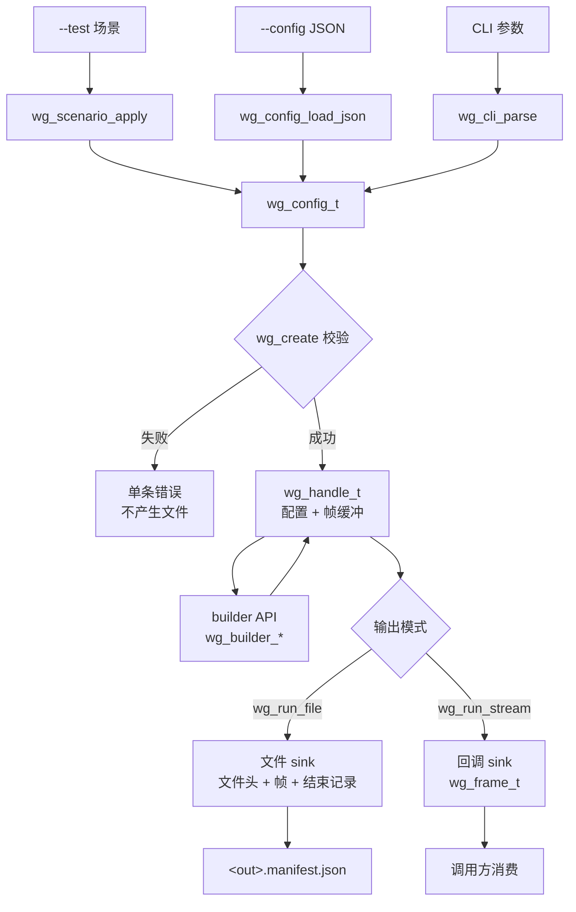

# WaveForge 架构

> WaveForge 是一个独立的 C99 软件波形发生器：把连续时间信号模型离散化为可复现的多通道波形文件或逐帧流。
> 本文描述两层架构、program 模型、调制叠加语义、file/stream 双输出与确定性边界。
> 相关文档：[输入格式](input-format.md) · [输出格式](output-format.md) · [信号目录](signal-catalog.md) · [校验口径](verification.md)

## 1. 设计目标

1. **独立性**：只依赖 C99 标准库；不引用任何被测设备、外部项目或私有报文格式。
2. **单一求值核心**：标准预设与用户自定义波形产出同一种 `wg_program_t`，采样器只认 program。
3. **连续时间优先**：先定义 x(t)，再按采样率离散化；频率变化一律用相位积分。
4. **确定性**：相同版本 + 相同配置 → 逐字节相同输出；时间戳用整数纳秒。
5. **有界资源**：生成状态 O(1)，帧缓冲固定，不缓存整段波形。
6. **可追溯**：每次运行输出 `<file>.manifest.json`，记录最终生效参数与 SHA-256。

## 2. 两层架构

| 层 | 代码位置 | 职责 | 不知道什么 |
|---|---|---|---|
| **Signal Core**（底层） | [`include/wg_signal.h`](../include/wg_signal.h)、[`src/wg_program.c`](../src/wg_program.c)、[`src/wg_sampler.c`](../src/wg_sampler.c) | 分量、每分量调制链、时间事件；定义“能产生什么波形”和求值规则 | 不知道 IEC 62586，也不知道测试编号 |
| **Preset Layer**（上层） | [`src/wg_scenario.c`](../src/wg_scenario.c) | 把标准测试默认值翻译成 Signal Core 原语 | 不直接写采样，只能调用 `wg_program_add_*` |

两层之间没有隐式共享：预设层只填默认值，不锁定参数。用户通过 CLI/JSON/C API 覆盖后，进入同一条求值路径。

### 2.1 模块职责

| 文件 | 职责 |
|---|---|
| [`src/wg_config.c`](../src/wg_config.c) | 默认配置、单层 JSON 解析、字段校验、未知字段拒绝 |
| [`src/wg_cli.c`](../src/wg_cli.c) | 命令行解析、合并顺序、`--mod`/`--phase-step` 物化为 program |
| [`src/wg_scenario.c`](../src/wg_scenario.c) | 场景表、预设构造函数、`NO_DEFAULT`/`CUSTOM`/`EXCLUDED` 返回 |
| [`src/wg_core.c`](../src/wg_core.c) | 配置复检、句柄创建、分段起点、时间戳、file/stream 共用循环 |
| [`src/wg_program.c`](../src/wg_program.c) | program 校验、builder API、分量/调制/事件求值 |
| [`src/wg_sampler.c`](../src/wg_sampler.c) | 逐样本生成、段切换、过零吸附、量化编码 |
| [`src/wg_signal.c`](../src/wg_signal.c) | 旧 `wg_signal_t` 求值路径（program 为空时使用） |
| [`src/wg_writer.c`](../src/wg_writer.c) | 文件头/帧头/结束记录、manifest、SHA-256 调用 |
| [`apps/wg_main.c`](../apps/wg_main.c) | CLI 入口（仅 file 输出） |
| [`tests/wg_selftest.c`](../tests/wg_selftest.c) | 13 项自测 |

## 3. 数据流



CLI 的合并顺序固定为：

`wg_config_default()` → `--system` → `--test` → `--config` → 其余覆盖项（按命令行出现顺序）。

`--test` 与 `--config` 可以同时给：先套预设，再用 JSON 覆盖。两者都不给时使用全局默认配置。

## 4. program 模型

```c
typedef struct {
    wg_component_t components[WG_MAX_COMPONENTS];
    uint16_t       component_count;
    wg_event_t     events[WG_MAX_EVENTS];
    uint16_t       event_count;
} wg_program_t;
```

`wg_program_t` 以值形式内嵌在 `wg_config_t.program` 中（只此一处），不会进入 `wg_signal_t` 或 `wg_segment_t`。

| 容量宏 | 值 | 含义 |
|---|---|---|
| `WG_MAX_COMPONENTS` | 96 | 全局分量数（基波/谐波/间谐波/载波共用） |
| `WG_MAX_MODULATORS` | 8 | 每个分量独立的调制链长度 |
| `WG_MAX_EVENTS` | 64 | 全局时间事件数 |
| `WG_MAX_CHANNELS` | 7 | `Ua/Ub/Uc/Ia/Ib/Ic/In` |

### 4.1 分量

| `kind` | 含义 | 频率来源 | 幅值基准 |
|---|---|---|---|
| `WG_COMP_FUNDAMENTAL` | 基波 | `cfg.signal.frequency` 或基波上的 `FREQ_*` | `amplitude_ref = 0`（nominal） |
| `WG_COMP_HARMONIC` | 谐波 | `order × φ(t)` | 默认 `amplitude_ref = 1`（基波瞬时 RMS） |
| `WG_COMP_INTERHARMONIC` | 间谐波 | `order × φ(t)`，`order` 可为 1.5/7.5/49.5 | `amplitude_ref = 0`（nominal） |
| `WG_COMP_TONE` | 独立载波 | 绝对 `frequency_hz × t` | `amplitude_ref = 0`（nominal） |

约束：

- 谐波 `order` 必须是 2–64 的整数；间谐波 `order > 0`，可为小数。
- 每个 program 至少要有一个基波分量；`FREQ_*` 调制器只允许挂在基波上，整个 program 最多一条。
- `channel_mask` 的 bit n 对应通道 n；`0` 表示所有已启用通道。

### 4.2 调制器

| `kind` | 语义 | 取用字段 |
|---|---|---|
| `amp_const` | 常数幅值因子 | `from`（%） |
| `amp_linear` | `duration_s` 内 `from → to` 线性，之后保持 | `from/to/duration_s` |
| `amp_triangle` | `period_s` 为完整周期，`from ↔ to` 往返 | `from/to/period_s` |
| `amp_step` | `start_s` 时刻由 `from` 跳到 `to` | `from/to/start_s` |
| `amp_sine` | `1 + depth/100 × cos(2π·fm·t + φ)` | `frequency_hz/depth_pct/phase_deg` |
| `amp_rect` | 占空比内 `1 + depth/200`，其余 `1 − depth/200` | `frequency_hz/depth_pct/duty_pct/phase_deg` |
| `freq_linear` | 频率 `from → to` 线性 | `from/to/duration_s` |
| `freq_triangle` | 频率三角，`period_s` 为完整往返 | `from/to/period_s` |
| `freq_step` | 频率在 `start_s` 阶跃 | `from/to/start_s` |

program 调制器的时间参数使用**全局绝对时间**（从样本 0 起算），不是段内局部时间。

### 4.3 事件

| `kind` | `value` 含义 | 实际效果 |
|---|---|---|
| `amp_step` | 幅值百分比 | 从 `time_s` 起把该通道**基波**幅值设为 `value`；以基波为基准的谐波随之缩放，间谐波/载波不变 |
| `phase_step` | 角度（°） | 从 `time_s` 起给积分相位加固定偏移；各分量按 `order` 缩放（见 §5.3） |

事件在 `wg_create()` 时按 `time_s` 稳定升序排序，同一时刻保持数组顺序。

## 5. 求值语义

### 5.1 相位积分

```text
φ[0]   = 0
φ[n+1] = φ[n] + 2π · f_eff(t_n) / fs
```

`f_eff` 的优先级：

1. 分段场景中该段 `signal.frequency`（仅当非零时）；
2. 基波上的 `FREQ_*` 调制器；
3. `cfg.signal.frequency` 轮廓（常数/线性/三角）。

禁止使用 `2π·f(t)·t`：频率变化时它会破坏相位连续性。

### 5.2 单通道合成

```text
v_ch(t) = Σ_i  A_i(t) · √2 · cos(θ_i(t))

基波:       A = nominal·amp_pct/100 · Π AMP_*        θ = φ(t) + phase_deg
谐波 ref=1: A = A_fund · amp_pct/100 · Π AMP_*       θ = order·φ(t) + phase_deg
谐波 ref=0: A = nominal·amp_pct/100 · Π AMP_*        θ = order·φ(t) + phase_deg
间谐波:     A = nominal·amp_pct/100 · Π AMP_*        θ = order·φ(t) + phase_deg
载波:       A = nominal·amp_pct/100 · Π AMP_*        θ = 2π·f_tone·t + phase_deg
```

`amp_pct = 100` 时基波 RMS 等于通道 `nominal`，峰值等于 `nominal × √2`。

### 5.3 相位跳变语义（实测）

`phase_step` 把偏移量加到积分相位 φ 上，因此：

| 分量 | 相位增量 |
|---|---|
| 基波 | `+value` |
| 谐波（order = h） | `+h × value` |
| 间谐波（order = m） | `+m × value` |
| 载波 `tone` | `0`（使用绝对频率与绝对时间） |

例：`value = +30°` 时，H3 实测 +90°，1.5 次间谐波 +45°，1060 Hz 载波不变。
若需要“每条谱线绝对 +30°”，当前实现不满足；这是已知待确认项，见 [项目日志](project-log.md) 的 ISS-020。

### 5.4 分段与过零切换

`segments[]` 为可选的一层时间线：

- 每段有自己的 `duration_s`、`transition`、`channel_delay_s` 和 `signal` 覆盖。
- `transition = immediate`：段起点立即切换幅值。
- `transition = zero_crossing`：段起点后，各通道在 `channel_delay_s` 之后的本相上升过零点切换。
- 段时长之和必须等于总 `duration_s`（允许 1e-9 的相对浮点余量）；否则拒绝。
- 段内只允许覆盖旧 `signal` 字段；`program` 只能在顶层定义，且 `--mod`/`--phase-step` 不允许与 `segments` 同用。

### 5.5 旧模型与 program 的差异

| 场景 | 旧 `signal` 路径 | program 路径 |
|---|---|---|
| 基波幅值调制 | `signal.modulation` 只乘基波项 | `amp_sine`/`amp_rect` 作用于所属分量 |
| 谐波幅值 | 与基波同乘 `amp_pct` 轮廓，但不随 `signal.modulation` 变化 | `amplitude_ref=1` 时以基波瞬时 RMS 为基准，会继承基波的幅值调制 |
| 频率轮廓 | `signal.frequency` 常数/线性/三角 | `FREQ_*` 或 `signal.frequency` 回退 |
| 事件时刻 | 无全局事件 | `events[]` 支持绝对时间与通道掩码 |

两者在 `program.component_count > 0` 时切换；`components` 优先于旧 `harmonics/interharmonics/tones/modulation`。

## 6. file 与 stream

| 模式 | 入口 | 行为 |
|---|---|---|
| file | `wg_run_file(handle, path)` | 写文件头 + 帧序列 + 结束记录，成功后再写 `<path>.manifest.json` |
| stream | `wg_run_stream(handle, emit, ctx)` | 逐帧回调 `wg_frame_t`，不落盘，不写 manifest |

两种模式共用 `prv_run_shared()` 与同一个帧缓冲：

- 帧头字段、样本字节、时间戳逐字节一致（selftest `file-vs-stream`）。
- stream 回调返回非 0 时立即停止，并把该值作为 `wg_run_stream` 的返回值。
- 同一个 `wg_handle_t` 可以多次调用任一模式；每次运行都从 `t = 0`、`φ = 0` 重新开始。

## 7. 确定性

1. 全部使用 `double` 相位积分，无隐式随机数、无种子字段。
2. 时间戳由样本序号整数计算（`n / fs` 与四舍五入），不累加浮点时间。
3. 输出只依赖：版本、最终配置、采样率、起始 UTC、样本格式。
4. 相同输入重复运行，`output_sha256` 必须相同；manifest 不参与哈希。
5. 编译器/数学库的 `cos` 实现差异可能带来末位差异；同一构建环境下逐字节一致是可复现判据。

## 8. 目录结构

```text
apm900-waveform-sim-20261118/
├─ CMakeLists.txt           CMake 构建（waveforge / wg / selftest）
├─ Makefile                 make 构建，产物在 build/
├─ include/
│  ├─ wg.h                  公共 API（create/run/builder/version）
│  ├─ wg_config.h           默认配置、JSON、场景、CLI
│  ├─ wg_signal.h           program 数据结构与追加原语
│  └─ wg_types.h            通道、格式、帧、配置结构
├─ src/                     实现（core/config/cli/signal/program/sampler/writer/sha256）
├─ apps/
│  └─ wg_main.c             CLI 入口
├─ tests/
│  └─ wg_selftest.c         13 项自测
├─ examples/
│  ├─ basic.json            基础 JSON 配置
│  ├─ harmonics.json        谐波配置
│  ├─ multi_modulation.json 组合调制
│  └─ builder_example.c     builder C API 示例
├─ tools/
│  ├─ verify.py             独立数学校验
│  ├─ check_acceptance.py   场景化测量与验收用例
│  └─ build.sh              make 包装脚本
├─ doc/                     公开文档（本目录）
├─ build/                   构建产物（gitignore）
└─ runs/                    本地运行证据（不随公开仓库分发）
```

## 9. 边界

WaveForge 只保证**数学保真与结构正确**：

- 不判定 IEC 合格与否；
- 不评估测量不确定度、标准限值与硬件精度；
- 不证明 ADC、模拟前端、抗混叠、互感器或真实时钟的性能。

标准预设中的所有数值都只是默认值，可被任意覆盖；标准原文需自行获取，本文档不替代标准。
